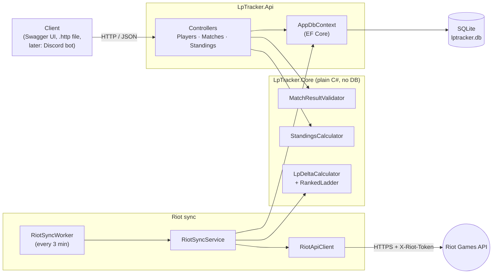
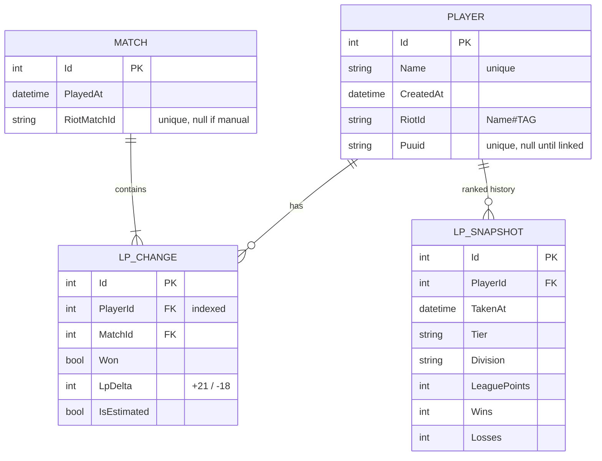

# LP Tracker API

A small ASP.NET Core Web API that tracks League of Legends LP (League Points) for a group of friends and serves a live leaderboard. Ranked games are pulled automatically from the Riot Games API, and games can also be entered by hand.

This is version 2 of a Discord bot I built in Python ([LPHelpy](https://github.com/bbuckland15/LPHelpy)). In version 1, a Discord command pulled each player's current rank from Riot's API, updated the standings, and saved them to a text file, rewriting the whole file on every update. It was a working minimum viable product used by the Nebraska Esports club to track standings for its varsity and junior varsity League players, and it already handled edge cases like promotions and demotions. It ran on my own PC; the plan was to move it to Google App Engine so it would always be available. Running it for the club showed me its limits:

- there was **no history**, because every save overwrote the last one
- a crash halfway through a save could **corrupt the file**
- every update **rewrote everything**, even though only one player changed
- simple questions like "LP gained this week" meant **parsing the whole file**
- it **only ran while my PC was on**, and the data only lived there

Version 2 rebuilds the core as a C# API on top of a relational database:

| Version 1 problem | Version 2 fix |
| --- | --- |
| Overwrote history | Every game result is its own `LpChange` row. It's inserted once and never rewritten. |
| Crash mid-write | A match and all its results save in one transaction: all or nothing. |
| Rewrote everything | One insert per player per game. `PlayerId` is indexed. |
| Hard to query | Standings, history and weekly totals are SQL queries (see [`docs/queries.sql`](docs/queries.sql)). |
| Tied to my PC | Standard SQL database. The provider can be swapped for SQL Server or Postgres on AWS RDS. |

## Tech stack

C# / .NET 8 · ASP.NET Core Web API (controllers) · Entity Framework Core · SQLite (locally) · Riot Games API (`HttpClient` + `BackgroundService`) · xUnit · Swagger

## Architecture



The business rules (validation and ranking) live in **LpTracker.Core**, which has no database or web dependencies. They can be unit tested in milliseconds, and they'd work unchanged if the database or the web framework changed.

## Data model



- **One player → many LP changes.** Deleting a player who has history is blocked (`Restrict`), so results are never lost silently.
- **One match → many LP changes.** Deleting a match entered by mistake cascades to its rows, and standings fix themselves.
- **Unique (MatchId, PlayerId):** a player can only have one result per match.
- **Standings are never stored.** They're calculated from the rows on each request, so they can't drift out of sync.
- **Unique RiotMatchId:** the same Riot game is never imported twice, and friends who played together share one Match row.
- **LP snapshots** record what Riot reported on each check. The sync compares the newest with the previous one to find new games.

## API

| Method | Route | What it does |
| --- | --- | --- |
| `GET` | `/api/standings` | Leaderboard: position, total LP, wins, losses, win rate |
| `GET` | `/api/players` | All players |
| `POST` | `/api/players` | Add a player (`409` if the name is taken) |
| `GET` | `/api/players/{id}/history` | A player's games in order, with a running LP total |
| `POST` | `/api/matches` | Record a game (`400` with a list of errors if invalid) |
| `GET` | `/api/matches/{id}` | One match and its results |
| `DELETE` | `/api/matches/{id}` | Remove a match entered by mistake |
| `PUT` | `/api/players/{id}/riot-account` | Link a player to their Riot ID (`{"riotId": "Name#TAG"}`) |
| `POST` | `/api/sync` | Check Riot for new games now, instead of waiting for the worker |

Example `POST /api/matches` body:

```json
{
  "playedAt": "2026-10-13T20:15:00Z",
  "results": [
    { "playerId": 1, "won": true,  "lpDelta": 21 },
    { "playerId": 2, "won": false, "lpDelta": -18 }
  ]
}
```

Validation rules (in `MatchResultValidator`):

- at least one result
- no player listed twice
- a win can't lose LP and a loss can't gain it (0 is allowed)
- at most 100 LP per game, to catch typos like 210 instead of 21
- `playedAt` can't be in the future

## How the Riot sync works

Riot's API doesn't have a "how much LP did this game give" field, so the sync works it out:

1. **Rank check.** Every 3 minutes, `RiotSyncWorker` asks Riot (League-V4) for each linked player's solo/duo rank: tier, division, LP, and season wins and losses.
2. **Compare with the last snapshot.** If wins + losses went up, there are new games. The LP change is worked out on a single ladder (`RankedLadder`), so a **promotion** from Gold I 90 LP to Platinum IV 10 LP counts as **+20, not −80**.
3. **Find the games.** Match-V5 gives the new ranked match IDs, plus when each game ended and whether the player won.
4. **Save in one transaction:** the matches, the LP changes and the new snapshot.

Edge cases handled:

| Situation | What happens |
| --- | --- |
| First check for a player | Saves a baseline only. Earlier games can't be imported because their LP isn't known. |
| Promotion or demotion | Handled by ladder points (tested). |
| Several games since the last check (e.g. the API was off) | The total LP is exact. It's split evenly across the games and each row is marked `IsEstimated`. |
| Rank updated but match history not yet | Nothing is saved, and the next check retries from the same baseline. |
| Dodge penalty (LP changed, no game) | No game recorded. The baseline moves. |
| New season (win/loss count resets) | No game recorded. The baseline moves. |
| Friends in the same game | One shared Match row with an LpChange per friend. |
| Same game seen twice | Skipped. The unique index on `RiotMatchId` is the backstop. |
| Rate limited (HTTP 429) | The run stops and waits for Riot's `Retry-After` time. |
| One player's request fails | Logged and skipped. Everyone else still updates. |

## Running it

You need the [.NET 8 SDK](https://dotnet.microsoft.com/download/dotnet/8.0). Check that it's installed with `dotnet --list-sdks`.

```bash
cd lp-tracker-api
dotnet test                              # run all tests
dotnet run --project src/LpTracker.Api   # start the API
```

Then open **http://localhost:5080/swagger** to try every endpoint in the browser. In development, the database is created on first run with four sample players and a few games. Sam has no games, to show that players with zero games still appear.

You can also open `src/LpTracker.Api/LpTracker.Api.http` in VS Code with the REST Client extension and click **Send Request** on each call.

To start over with a fresh database, stop the API and delete `src/LpTracker.Api/lptracker.db`. **Do this after pulling schema changes.** The app creates tables with `EnsureCreated`, which won't update an existing database.

### Connecting to Riot

1. Sign in at [developer.riotgames.com](https://developer.riotgames.com) and copy your development API key. It starts with `RGAPI-` and **expires every 24 hours**, so regenerate it when calls start returning 401 or 403.
2. Store it outside the code. It's never committed:
   ```bash
   dotnet user-secrets set "Riot:ApiKey" "RGAPI-your-key" --project src/LpTracker.Api
   ```
3. If you're not on NA, change `Platform` and `Region` in `appsettings.json` (e.g. `euw1` and `europe`).
4. Start the API. Link a player with `PUT /api/players/1/riot-account` and body `{"riotId": "YourName#NA1"}`.
5. Call `POST /api/sync` once to save the baseline. Play a ranked solo/duo game, then sync again, or wait for the worker.

Without a key, the API still runs normally. Automatic sync is simply off.

## Testing

| Test file | What it covers | Database? |
| --- | --- | --- |
| `StandingsCalculatorTests` | Ordering, ties sharing a position (1, 2, 2, 4), alphabetical tie-break, win rate with zero games | No |
| `MatchResultValidatorTests` | Every validation rule above, including a `[Theory]` for win/loss sign | No |
| `RankedLadderTests` | Tier, division and LP → ladder points, including Master+ | No |
| `LpDeltaCalculatorTests` | Promotion, demotion, Master promotion, dodge, new season, multi-game split always adding up to the total | No |
| `RiotSyncServiceTests` | Full sync with a **fake Riot client** on in-memory SQLite: baseline, a single win, promotion, no duplicates, duo games sharing a match, estimated splits, waiting for match history, skipping unlinked and unranked players | Yes, in-memory |
| `StandingsQueryTests` | The real standings query against an in-memory SQLite database: wins add and losses subtract, **players with no games still appear**, ranking across matches, deleting a match updates standings, unique constraints | Yes, in-memory |

The database tests use SQLite in memory, so they run against real SQL but need no setup and leave nothing behind.

## Design decisions

- **Insert-only LP history:** an audit trail for free, plus easy corrections and simple "what changed" questions.
- **Business logic separated from data access:** keeps the logic easy to test and keeps the controllers thin.
- **The database is the safety net:** the validator gives friendly errors, and unique indexes still catch anything that slips past it, such as two requests at the same time.
- **SQLite for now:** zero setup locally. Moving to SQL Server or Postgres means changing one line in `Program.cs` and the provider package.
- **`IRiotApiClient` interface:** the sync logic is tested with a fake client, with no API key or network.
- **`TimeProvider` instead of `DateTime.UtcNow`:** the tests control the clock.
- **`IHttpClientFactory` (`AddHttpClient`):** pools connections properly instead of creating a `new HttpClient()` per call.
- **Secrets in user-secrets, not appsettings:** the API key never reaches Git.
- **`EnsureCreated` for now:** a real deployment would use EF Core migrations, so schema changes are versioned and repeatable.

## What I'd build next

1. **Live updates:** push new standings to clients with SignalR (WebSockets) instead of making them refresh.
2. **Discord bot as a client:** a `!standings` command that calls this API instead of reading a local file.
3. **Production setup:** EF Core migrations, SQL Server or Postgres on AWS RDS, the API in a container on ECS Fargate, CI with GitHub Actions running `dotnet test` on every push.
4. **Production Riot key and smarter polling:** request a personal or production key, and back off for players who haven't played in a while.
5. **Auth:** so only our group can record or delete matches.
